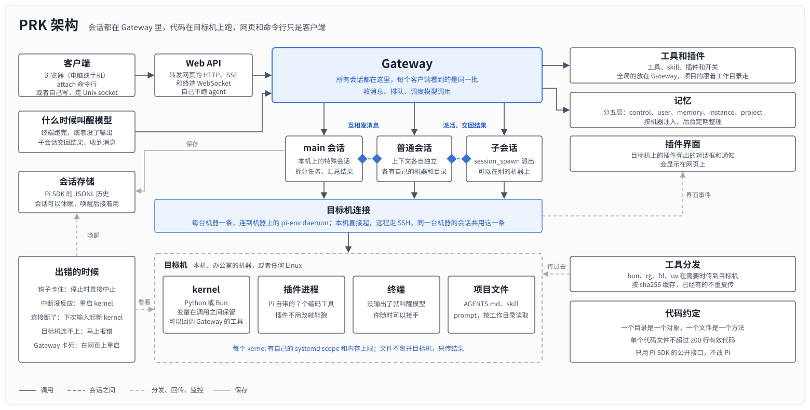

# PRK (pi-remote-kernel)

English · [简体中文](README.zh-CN.md)

**One brain, hands on many machines.** PRK is an always-on agent host built on the [Pi SDK](https://pi.dev/). It keeps state, compute and entry points in three separate layers:

- **The brain is the Gateway.** Every session, queue and scheduling decision lives in this one process.
- **The hands are your target machines**: this one, or any Linux box you can log into without a prompt (usually over SSH). Code runs there and files stay there; only results come back.
- **Entry points just watch and talk**: the browser, the command line, or a client you write yourself. They all see the same sessions, and disconnecting never interrupts running work.



## The brain: the Gateway

- **Sessions.** Each session is bound to a machine and a working directory, with its own context. A session can `session_spawn` child sessions to work in parallel, and their results are handed back to the parent automatically; sessions can also message each other directly.
- **Event wake-ups.** A terminal finishing or going quiet, a child session delivering its result, or a new inbox message wakes the model to carry on, so nobody has to babysit it.
- **Capability catalog.** Tools, skills, plugins and switches are managed in one place. Global ones come from the Gateway; project ones follow the session's working directory, using Pi's lookup rules.
- **Memory.** Layered long-term memory, injected per session and per machine, with background review that keeps it tidy.
- **Pi, unmodified.** Models, providers and extensions are configured the Pi way, and the Pi SDK still owns session history, branching and context compaction. PRK does not modify Pi.

## The hands: target machines

- **A kernel that stays up.** `kernel_code` runs Python in the session's own namespace, or Bun for JavaScript/TypeScript. Variables, imports and data loaded into memory survive between calls.
- **Files stay put.** Read, write, edit and grep run on the target and return only results.
- **Terminals.** The model can open a terminal for long-running commands; you watch the same screen in the browser and can take over at any time.
- **Plugin host.** Pi's seven built-in coding tools and plugins can run on the target itself, and the dialogs and notifications they raise show up in the web UI.
- **Project resources.** `AGENTS.md`, skills and prompts are read from the session's working directory, following Pi's rules.
- **Isolation.** Each kernel runs in its own systemd scope with a memory limit, so an OOM only kills the process that caused it.
- **Easy deployment.** The Gateway pushes its daemon and tools (`bun`, `rg`, `fd` and so on, cached by sha256 so nothing is re-sent) to the target. The target needs Python 3.9+, or PRK can deploy a managed Python.

## When things go wrong

Sessions can sleep and wake without losing history. If a kernel dies or a connection drops, the next input starts a fresh kernel and work continues; an unreachable target fails fast instead of hanging. A stuck Gateway can be restarted from the web UI in one click.

## Read this first

PRK is meant for one person on their own machines and private network. **The web UI has no login: anyone who can open it can run arbitrary commands on your targets.** It listens on `127.0.0.1` by default; reach it from another computer through an SSH tunnel and never expose it to the internet.

Linux only for now. The project is moving fast, and configuration formats and interfaces may change without a migration path. Most design docs are written in Chinese.

## Quick start

You need Node.js 22.19+, Python 3.9+, and the `bun`, `rg` and `fd` executables.

```sh
git clone https://github.com/shttty/prk-agent.git
cd prk-agent
scripts/prk.sh install
# import bun / rg / fd and configure a model provider: steps 2 and 3 of the install guide
scripts/prk.sh start
```

Then open <http://127.0.0.1:8787/>.

The [install guide](INSTALL.md) (Chinese) covers importing the tools, connecting a model and checking that the model can actually call the kernel.

## Documentation

- [Install guide](INSTALL.md): installing, connecting a model, smoke checks, day-to-day start/stop and troubleshooting.
- [Configuration](docs/configuration.md): the PRK home, `config.toml`, `instances.toml` and the Pi settings under `agent/`; fields for local and remote instances are in the [instance reference](docs/configuration/instances.md).
- [Gateway wire protocol](docs/wire/) and [cross-process contract](docs/contract.md): start here if you are writing your own client.
- [Kernel tool modules](docs/kernel-tools.md): adding your own Python tools to the kernel.

## Development

```sh
npm ci && npm --prefix web ci
npm run check         # TypeScript
npm run check:unit    # unit tests
npm run check:quick   # cross-process smoke tests; Python and browser requirements in docs/kernel-recovery.md#test-environment
```

For frontend work, `PRK_API=http://127.0.0.1:8788 npm --prefix web run dev` starts Vite with hot reload against the API started by the launcher.

The code is organized as "a directory is an object, a file is a method", and no code file exceeds 200 effective lines. Read [AGENTS.md](AGENTS.md) before changing anything; it holds the project's ground rules. Settled decisions and planned work are in [PLAN.md](PLAN.md).

## License

[MIT](LICENSE), copyright 2026 Iris Rinne. [docs/pi-sdk](docs/pi-sdk/README.md) is taken from the Pi documentation and keeps its upstream MIT notice; bundled third-party assets such as fonts keep their own licenses.
