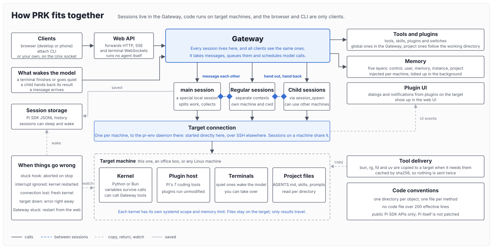

# PRK (pi-remote-kernel)

English · [简体中文](README.zh-CN.md)



PRK is an agent host built on the [Pi SDK](https://pi.dev/) that stays up on one machine. I wrote it because I wanted a model to work across several machines without installing an agent on each of them, and without shipping files back and forth between them.

So PRK splits the work three ways. The Gateway is the only process that manages sessions; conversation history, queueing and scheduling all live there. The actual work happens on target machines: the Gateway starts a daemon on each one over SSH (or any command that logs in without a prompt), the model's code runs there, files are read and written there, and only results come back. The browser and the command line are just clients. Close the tab, open it again from another computer, and the session is still where you left it.

## What it's like to use

Each session gets a long-lived kernel on its target, Python by default, or Bun if you want JavaScript or TypeScript. Data loaded and variables computed in one call are still there in the next, so nothing has to be reloaded. That matters a lot when you're analyzing data or poking at a live system.

Reading, editing and grepping files all happen on the target. Slow commands can go into a terminal; when the command finishes or goes quiet for a while, the model is woken up to deal with it. The browser shows the same terminal, so you can take over whenever you need to.

A session can spin off child sessions to work in parallel, on other machines if you like, and their results are handed back when they're done. Sessions can also message each other directly.

Models, providers, extensions and skills are all configured the way Pi configures them. Conversation history, branching and context compaction are the Pi SDK's own; PRK doesn't patch Pi.

In the browser you can chat, browse and edit files on the target, open terminals, and manage sessions, machines and plugins. It works on a phone too.

## When things break

Every kernel runs in its own systemd scope with a memory limit, so running out of memory kills only that kernel. If a kernel dies or the connection drops, the next message starts a new one. An unreachable target fails right away instead of hanging. Sessions can sleep, and their history is all there when they wake up. If the Gateway itself gets stuck, you can restart it from the web UI.

## Before you run it

PRK is built for one person working on their own machines and private network. The web UI has no login: anyone who can open it can run any command on your targets. It listens on `127.0.0.1` by default. To reach it from another computer, use an SSH tunnel; don't put it on the internet.

Linux only for now. The project changes often, and configuration formats and interfaces can change without a migration path. Most of the design docs are in Chinese.

## Install

You'll need Node.js 22.19+, Python 3.9+, and the `bun`, `rg` and `fd` executables, which PRK hands out to targets.

```sh
git clone https://github.com/shttty/prk-agent.git
cd prk-agent
scripts/prk.sh install
# import bun / rg / fd and set up a model: steps 2 and 3 of the install guide
scripts/prk.sh start
```

Then open <http://127.0.0.1:8787/>. The full steps for importing the tools, connecting a model and checking that the model can really call the kernel are in the [install guide](INSTALL.md) (Chinese).

## Docs

The [install guide](INSTALL.md) covers installing, connecting a model, smoke checks, starting and stopping, and troubleshooting. The [configuration reference](docs/configuration.md) covers the PRK home, `config.toml`, `instances.toml` and the Pi settings under `agent/`; settings for local and remote machines are in the [instance reference](docs/configuration/instances.md). If you want to write your own client, read the [Gateway protocol](docs/wire/) and the [cross-process contract](docs/contract.md). To add your own Python tools to the kernel, see [kernel tool modules](docs/kernel-tools.md).

## Development

```sh
npm ci && npm --prefix web ci
npm run check         # TypeScript
npm test             # typecheck, unit tests, Web and contract lint
npm run check        # also integration, Chromium journeys, and Web build
```

For the full check prerequisites, see [test environment](docs/kernel-recovery.md#test-environment).

For frontend work, `PRK_API=http://127.0.0.1:8788 npm --prefix web run dev` starts Vite with hot reload against the API the launcher started.

The code is organized by directory: a directory is an object, a file is a method, and no code file goes over 200 effective lines. Please read [AGENTS.md](AGENTS.md) before changing anything; the project's rules are there. Decisions already made and planned work are in [PLAN.md](PLAN.md).

## License

[MIT](LICENSE), copyright 2026 Iris Rinne. [docs/pi-sdk](docs/pi-sdk/README.md) is taken from Pi's documentation and keeps its upstream MIT notice. Bundled third-party assets such as fonts keep their own licenses.
