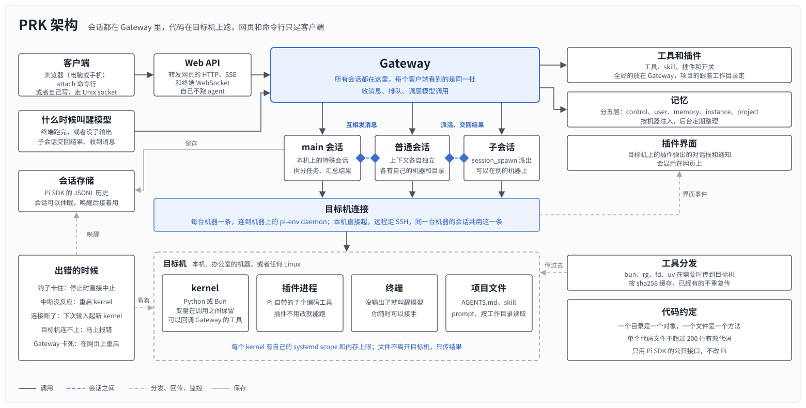

# PRK（pi-remote-kernel）

[English](README.md) · 简体中文

**一个大脑，多台机器的手脚。** PRK 是基于 [Pi SDK](https://pi.dev/) 的 agent 宿主，7×24 常驻。状态、计算和入口分在三层：

- **大脑是 Gateway**：所有会话、排队、调度都在这一个进程里。
- **手脚是目标机**：本机，或任何能免交互登录的 Linux 机器（通常走 SSH）。代码在那里跑，文件留在那里，只把结果传回来。
- **入口只负责看和说**：浏览器、命令行，或者你自己写的客户端。几个入口看到的是同一批会话，断开重连不影响正在跑的活。



## 大脑：Gateway

- **会话**：每个会话绑定一台机器和一个工作目录，上下文互相隔离。会话可以用 `session_spawn` 派出子会话并行干活，结果自动交回父会话；会话之间也能直接发消息。
- **事件唤醒**：终端跑完或安静下来、子会话交回结果、收件箱来了消息，都会把模型叫醒接着干，不用人盯着。
- **能力目录**：工具、skill、插件和开关集中管理。全局的来自 Gateway，项目级的跟着会话的工作目录走，查找规则和 Pi 一致。
- **记忆**：分层的长期记忆，按会话和机器注入，后台自动复盘整理。
- **沿用 Pi**：模型、provider、扩展按 Pi 的方式配置；会话历史、分支和上下文压缩仍由 Pi SDK 管理，PRK 不改 Pi 本体。

## 手脚：目标机

- **常驻 kernel**：`kernel_code` 在会话自己的命名空间里执行 Python，也可以切成 Bun 跑 JavaScript / TypeScript。变量、导入的库、读进内存的数据在多次调用之间一直都在。
- **文件不回传**：读、写、改、grep 都在目标机上执行，只回结果。
- **终端**：模型可以开终端跑长命令，你在网页里看得到同一个屏幕，随时能接手。
- **插件宿主**：Pi 原生的 7 个编码工具和插件可以直接跑在目标机上，插件弹的对话框和通知会透传到网页。
- **项目资源**：`AGENTS.md`、skill、prompt 按会话的工作目录、照 Pi 的规则读取。
- **隔离**：每个 kernel 跑在自己的 systemd scope 里，有内存上限，OOM 只杀出事的那个进程。
- **部署省心**：Gateway 会自动把 daemon 和工具（`bun`、`rg`、`fd` 等，按 sha256 缓存，命中不重传）下发到目标机。目标机要有 Python 3.9 以上，或者让 PRK 部署一份托管 Python。

## 出事了怎么办

会话可以休眠和唤醒，历史不会丢。kernel 崩了或连接断了，下一次输入会起一个新的 kernel 接着干；目标机连不上时立刻报错，不会卡住等。Gateway 卡死可以在网页上一键重启。

## 先看适用范围

PRK 是给一个人在自己的机器和内网里用的。**网页没有登录，能打开网页的人就能在目标机上执行任意命令。** 默认只监听 `127.0.0.1`，要从别的电脑访问请走 SSH 隧道，不要直接暴露到公网。

目前只支持 Linux。项目还在快速开发，配置格式和接口可能会有不兼容的改动。设计文档大多是中文。

## 快速开始

需要 Node.js 22.19 以上、Python 3.9 以上，另外要准备 `bun`、`rg`、`fd` 三个可执行文件。

```sh
git clone https://github.com/shttty/prk-agent.git
cd prk-agent
scripts/prk.sh install
# 导入 bun / rg / fd，配置模型 provider：见安装指南第 2、3 步
scripts/prk.sh start
```

然后打开 <http://127.0.0.1:8787/>。

导入工具、接模型、确认模型真的能调用 kernel，完整步骤都在 [安装指南](INSTALL.md) 里。

## 文档

- [安装指南](INSTALL.md)：安装、接模型、验收、日常启停和排错。
- [配置参考](docs/configuration.md)：PRK home、`config.toml`、`instances.toml`，以及 `agent/` 下的 Pi 设置；本机和远程实例的字段见[实例参考](docs/configuration/instances.md)。
- [Gateway 协议](docs/wire/) 与[跨进程约定](docs/contract.md)：想自己写客户端时看这里。
- [kernel 工具模块](docs/kernel-tools.md)：给 kernel 加自己的 Python 工具。

## 开发

```sh
npm ci && npm --prefix web ci
npm run check         # TypeScript 检查
npm run check:unit    # 单元测试
npm run check:quick   # 跨进程冒烟测试，需要的 Python 和浏览器见 docs/kernel-recovery.md#test-environment
```

前端开发时可以用 `PRK_API=http://127.0.0.1:8788 npm --prefix web run dev` 起热更新的 Vite，连到启动脚本拉起的 API。

代码按“目录即对象、文件即方法”组织，单个代码文件不超过 200 行有效代码。动手前请先读 [AGENTS.md](AGENTS.md)，里面是项目约束；已定的决策和后续计划在 [PLAN.md](PLAN.md)。

## 许可证

[MIT](LICENSE)，版权所有 2026 Iris Rinne。[docs/pi-sdk](docs/pi-sdk/README.md) 摘自 Pi 官方文档，保留上游的 MIT 版权声明；随仓库分发的字体等第三方资源保留各自的许可证。
