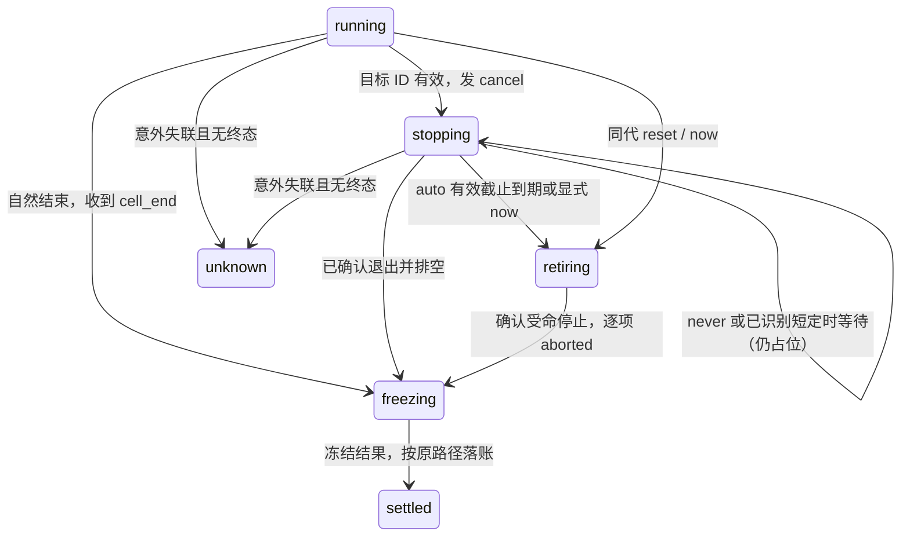

# MCELL｜一个会话、一代一个解释器、默认四个执行位

基线 `99845685`。Python 的 `thread` 与 `async` 共享主 kernel 的同一个 globals；`isolated` 只交换显式指定的值。Bun 在自己的事件循环共享 `globalThis`。同一会话只开一代，所有 cell 共用一张执行位表；取消请求不等于退出并排空。
依据：[Python 初测](research-py.md)、[停止阶梯与 forkserver 实测](probes/results.md)、[Bun 1.4.4 实测](research-bun.md)、[KASYNC 决定](kasync-final-decisions.md)、仓库 `docs/wire/kernel.md`。目标 CPython ≥3.9；系统调用解码只支持 Linux x86_64。

## 1．准入和所有权：扩展 `KernelCell`，不新建调度系统

- 会话保存 `kernelLanguage`（默认 `python`）；同一时刻至多一代活 kernel。`KernelProcess` 仍拥有目标 lease、generation、scope、唯一协议连接、请求序号和消费窗口。Python/Bun 仅替换启动载荷、prelude、runner 和工具描述，不复制 Gateway 生命周期。
- `kernel-state.ts`、`cell/{execute,run,read-cell}.ts`：以 `Map<cellId,KernelCell>` 替换 `ctx.cell/execution/inflight` 单槽。每次 execute 生成 UUID（不是位号）；首次 await 前同步检查维护闸门和表长、预占位，并在失败时释放。冷启动复用一次 `starting/ensure/initialize`；等待同一启动的已准入请求也占位。尚未发 execute 即被退休者报 `submitted:false`，不算连带停止。
- N 是本代上限，两端相同。满位、维护中或消费窗口无法容纳 execute，立即 transient `BUSY`，不排队、不退休进程。yield、ask、read、stopping 都不释放位。`cell_end` 确认执行帧；该项结果冻结后释放位。已 yield 的结果仍由既有 `pendingFinished`/历史层持有直到落账/处理失败，不为等待 Pi 投递一直占计算位。
- `KernelCell` 自己持有计时器、前台 promise、SDK 上下文、取消源、请求/回复块、输出/图片和冻结结果；按 `(generation,cellId,requestId)` 配对。`clear/delete/library` 更新、切语言均需整代空闲；`reset` 是唯一允许主动打断忙代的维护入口。handoff/归档/休眠检查准入中、运行、停止中、冻结及待落账的**所有**项。
- `asyncExecution` 只决定本次调用是否 yield/提醒，不是并发数；关时保留原同步有限执行期限。已 yield 的每个 cell 按原策略可读、可停、有通知。SDK 保留 sequential 工具声明：常见路径是 A yield 后再提交 B，不要求 Pi 并行执行工具。

## 2．保留 KASYNC 的时间和历史语义

|机制|从一位到 N 位的改动|不变的约束|
|---|---|---|
|yield / `kernel_read`|按 ID 等本 cell 的 `done` 或其前台墙钟|先收到 `cell_end` 则等规范化后直接返回；先 yield 则先写所属分支 open，再返回 running；读不消费结果、不重置钟|
|提醒|每项独立累计 active 时间；只在本项 ask 暂停；附任务名、状态和同代运行列表|默认 1/5/15/30 分钟，之后每 30 分钟；不因输出、读、别的 cell 结束而重计|
|结算窗|`plugins/kernel/bind-cell-events.ts` 保留每个 SDK run **一个** `waitForIdle` fence；每个未提交的 checkpoint/finished 捕获自己的身份、分支、停止标记|Pi 报 idle 而前轮未真正结算时先扣住；结算后按产生顺序逐条复核。失效 checkpoint 撤回；已落账 finished 不要求 cell 仍在活表。用户停止不触发新轮，不接管 SDK 队列|
|落账|`sessions/history/kernel-cells/` 原 open/result 按 UUID 各一次；主动退休也为每个已 yield 的受影响项走同一条结果路径|同分支先存结果再尝试一次 finished；送达凭原生历史同 eventId。前台只返回原父结果，不另造父工具行；交接等落账不等送达|
|崩溃对账|逐 ID 对照活表、open、result、原生事件；已知主动退休结果保留|仅 open 且已失代 → unknown；有结果无通知凭据 → unconfirmed；写失败 → unsaved、活 Gateway 可读。不补跑、不自动重发|

提醒正文给三个动作：继续等（不调用工具）、按 ID 读快照、按 ID 定向停；停止中可选择保留其他任务继续等，或 `restart:"now"`。展示同伴不是让模型逐项轮询。

## 3．中断：把请求、退出和退休分开

- `kernel_interrupt {cell_id,restart?:"auto"|"never"|"now"}` 是 model-only。省略取全局策略；auto 先定向，普通卡点按 N 秒升级，已确认的纯定时等待按 §4 的有界特例；never 不升级；now 明确要求退休目标所在整代（包括 isolated 的同伴）。旧 ID 不能退休新代。
- Gateway 受理即在自己的单调钟开始 N 秒计时，标 stopping、撤本项 callback/ask 并拒新回调，不等 runner ack。thread 走 §4 阶梯；async 先按 Task 取消，只对已证实占住共享 loop 的目标走线程阶梯；isolated 只停自己的组，Bun 撤本项 handle。已有自然终态保留；取消回执不是退出证据。
- `auto` 返回 `{status:"requested",cell_id,restart,grace_ms,peers}`；`never` 最多等剩余宽限，若已停返回真结果，否则返回 `{status:"stopping",cell_id,blockedAt,observedAt,peers:[{cell_id,title,state}],restart:"never"}`。再次 never 立即给现状；后续 read、提醒也给同一快照。该 cell 继续占**一个**位，别的空位仍可用。重复请求不重复注入/计时；退休闸门落下前可显式改策略，从初次受理时间计算；now 优先，落闸后不可撤销。
- `cell_state.blockedAt` 是本次取消的有界分步记录：`[{step,observedAt,status,evidence,action?,errno?,remainingMs?}]`，每步示明命中、跳过原因、动作和复核结果；不传指针/内存正文。read、提醒、停止回执和浮条展开行共用同一投影。例：「recvfrom(fd 7, TCP …:22)，已对副本 shutdown，待线程退出」「pselect6 无 fd，sleep 剩余 ≤42s」。若冻结、无权限或采样变动，给出最后观测及时间，当前写未知。
- 到期或 now：一把代级闸门，先 fence 准入和旧帧，截取**已提交且尚无终态**的 `{kernelId,cellId,taskName}` 清单；保留已收 cell_end（即便还在缩图），取消本代待处理 ask/回调。`process/{interrupt,retire,stop}.ts` 拆开「禁止使用」「目标进程树清理」「逐项结算」；现有 `retire()` 无条件 resolve(unknown) **不能**先调。整代只执行一次外部 stop；多个 now/reset 不能产生多份清单或新代。
- 复用 target exec 停**所属 scope**，有界等 scope 空和 runner/已知子组退出；unscoped 时清本代 PGID 及已登记的独立子组并核验，不能只杀父 PID。已确认的主动退休是产品终态：发起项和**每个连带项**记 `outcome:aborted,reason:"kernel 重启"`，结果/事件含 `cause`、`initiatorCellId?`、`affectedCells[]`（含本人，区分发起/连带）。`now` 回执及 reset 结果也给清单。用户来源另存，不覆盖该 reason。
  若发起退休的原因是 **thread cell 定向停止超期**，在该项冻结结果的模型正文中追加「这类可能卡在 DNS、C 运算或同步调用的任务，下次请用 `mode:"isolated"`」，details 记 `suggestedMode:"isolated"`；前台结果、后台 finished 与以后 read 读同一结果。不是其他同代 cell 的错误，不给连带项、意外断链或主动 reset 加这条建议。
- 清理动作失败不能报告进程已停：返回 `cleanup:unconfirmed`、旧代不可再用、列明对象；具有退出证据的项不改 unknown。**意外断链/崩溃、没有结束证据**才按 KASYNC 对账，不把正常升级的同伴结成 unknown。不声称已清逃出 scope 的进程或已撤回远端请求。不得在旧活进程未能排除时再启动第二个活 kernel（见 O3）。
- 网页按停止走全局默认，不露策略菜单。浮条每行和 ask 按钮用 `cellOnly:true` 携所见 generation/cellId；不取消别的 SDK operation。composer 停止用当前 operationId 和明确选中的 cell；只有一项可沿旧行为，多项且未选只取消当前轮，不默认选最早者。用户引起的退休给清单上所有项设 `userStopped`，撤它们未派发提醒，终态入历史/Web 但 `triggerTurn:false`。未受影响兄弟保持原通知。
- 退休丢 namespace。`kernel_interrupt(now/auto升级)` 不后台造新代，下一次明确 execute 才 ensure。`kernel_code(reset:true)` 自己就是明确请求：无论满位与否均先走 now，等退休/旧结果冻结落账，再同语言初始化；空代码只重启，非空只在新代成功后执行一次。失败不执行代码，已完成结果仍可按旧 ID 读取。

## 4．目标 Python 决定模式，三种模式共享一个并发上限

Gateway 先预占位并快照 `defaultCellMode`；execute 携显式 `mode?` 与该默认值，**不在 Gateway 分析 Python**。目标 runner 在执行前决定一次有效模式，随 `cell_admitted` 回报；running、提醒、浮条和终态都用实际模式。`asyncExecution` 是是否 yield 的开关，与 Python 的 `mode:"async"` 无关。

|准入条件（从上往下，取第一项）|有效模式|
|---|---|
|显式 `mode` 为 `thread`、`async` 或 `isolated`|完全服从显式值，包括显式 thread + 顶层 await、显式 async + 普通同步正文|
|未传 mode，原始 cell 的模块 code object 有 `inspect.CO_COROUTINE`|`async`，即使全局默认是 isolated|
|未传 mode，未置该标志|准入时的全局默认；未配置为 `thread`|

目标解释器对整段源码用 `compile(..., 'exec', flags=ast.PyCF_ALLOW_TOP_LEVEL_AWAIT, dont_inherit=True)` 查 `code.co_flags & inspect.CO_COROUTINE`；在拆末表达式或套 isolated 的 async 函数**之前**判定。注释/字符串中的 await、仅定义 async def 不触发；顶层 async with/async for 按编译标志处理。若默认 isolated 且省略 mode，允许 isolated 专有 `return`：仅在模式探测用的 AST 中把模块作用域的 return 换成对应表达式（不进嵌套函数/类），仍由编译标志分流；选定后按目标模式编译原文，语法不合法直接报错，不切模式重试。带顶层 await 又要 `return` 传值时显式选 isolated。

### thread：普通同步代码，每 cell 一条执行线程

`src/kernel/runner/assemble-runner.py` 保留唯一原生控制 reader 和串行 writer。thread 用短寿命 `threading.Thread` 运行于主 globals。**显式 thread + 顶层 await** 在此 worker 的私有 loop 中运行，随 cell 收尾关闭，不送往共享 loop。执行/登记/退出与发送终态分工：控制路径不注入 reader、排水线程或 runner 结算代码。

取消按以下顺序执行；一旦执行已结束即转收尾。`time.sleep`、socket、`subprocess.run/communicate/wait` 均是原版。不插入导入代理，不要求用户改写调用。

1. **注入一次。** 锁内匹配 `(generation,cellId,Thread)`，只在用户执行阶段以 `Thread.ident` 调 CPython `PyThreadState_SetAsyncExc`；0 为未命中，1 只是已排队，异常计数不得继续动作。未起则标取消；已知本 loop 的 await 可用该 loop 的公开线程安全取消入口。真正已退即结束，不重复向 finally、控制线程或已复用线程号注入。
2. **读取本线程阻塞证据。** 用 `native_id`（不是 `ident`）读 `/proc/self/task/<tid>/syscall`；解析 x86_64 原生 ABI 的 syscall 号、参数及必要的等待集合。进程内有界只读复制（如 `pread(/proc/self/mem)`），不解引用未经检查的裸地址。操作前再次验证 cell/线程、调用、参数和集合；`running`、线程消失、ABI/权限未知、部分读取或证据变化均不做破坏动作。本机 ptrace_scope=1 可读自身线程，无需提权。
3. **纯定时等待不强唤醒。** `clock_nanosleep/nanosleep`，或 `select/pselect6/poll/ppoll` 的 nfds=0、无有效 fd 且有有限 timeout。按实际 ABI 区分 timeval 微秒、timespec 纳秒、poll 毫秒。`clock_nanosleep(CLOCK_MONOTONIC,TIMER_ABSTIME)` 用同 clock 的绝对值减当前时刻；相对参数（含 3.9 pselect6）只给上界。NULL/无限、无效时钟/数值不授予延时。3.12.13 / 3.9.25 原样 sleep 的实测均是正常等待结束后才抛已挂异常。
   Gateway 在普通宽限内收到已验证 `remainingMs ≤ maxTimerWaitMs`（默认建议 300000）才一次性允许等待，仍为 stopping；显示「预计最多 X 秒后退出，逾期升级」，不是退出保证。传**时长**，不跨机器相减单调时间；从接收时置本地有界截止，不因重复采样、第二次 sleep、吞异常而续期。截止检查先取已到达的 cell_end；仍活即走升级，不再加一个 N。超过上限、样本迟到或无法读数不延长普通 N；never 继续占位、now 立即打断特例。原 N 很短而 cell_state 尚未收到时按普通策略，不依赖冻结的 runner 定时器。
4. **pin 再 shutdown。** 仅直接 recv/read/connect 等 socket，或 poll/select 集合中能唯一辨认的候选；解析 DNS/libc resolver、UDP、epoll 混合或多义集合不试。记录首次 `fstat(N)` 的 socket 类型与 dev/ino，`D=dup(N)`；再采样确认仍是同一等待且仍含 N，比对首次身份、`fstat(D)` 与新的 `fstat(N)`。不匹配即拒；匹配才对 **D** `shutdown(SHUT_RDWR)`，finally 关闭 D。TCP 类型/端点从 D 查询；握手中无可取对端则如实记。不得对 N shutdown/close、不得以 AF_UNSPEC 或扫描全部 fd 兜底。
   [复用探针](probes/fd_lifetime.jsonl)：即使两次 syscall 字段完全相同，首次身份到 dup 间复用也可能使新的 N 与 D 相等；必须保留首次身份。dup 后检验前复用会被拒；检验后复用只对 D 指向的旧连接生效。**这固定的是取得 D 时的打开文件描述，不是原子取得内核等待对象**：若第一次 fstat 前就已换号，单靠 `/proc` 快照无法证明历史对象。可疑/不一致拒绝；不能承诺任意并发 close 下零误伤。共享同一连接者也会收到 EOF/错误，属已接受影响，不因此把它们标成 cancelled。
5. **按被取消 worker 此刻的子进程等待对象停止，不按创建线程。** 只接受明确正 PID 的阻塞 `wait4` 或等价的 `waitid` 退出等待。确认目标是本 runner 的子进程，打开 pidfd 固定身份，再核对同一个已登记、已取消的 worker 仍在相同的调用中等待同一目标。仅当目标确认为独立进程组组长且不在 kernel 组时，才经 pidfd 的 `PIDFD_SIGNAL_PROCESS_GROUP` 向该组发 SIGKILL；否则只经 pidfd 停该进程。目标 Linux 不支持所需 pidfd 操作时不发信号，不降级使用数字 PID/PGID。任意/组等待、无法固定或复核的目标一律不发信号。
   `communicate` 等读管道的 `read`/`poll`：只在本 runner 的直接子进程范围内核对同一管道的写端，不能按进程表猜归属。须完整核验等待集合和管道身份，每条等待管道都恰有一个已确认的子进程写者且指向同一子进程；多个写者、混合或多义集合、runner 自留写端、证据缺失或变化均不发信号。信号发出后仍须等原有等待路径实际回收目标；不抢占退出状态，不把管道 EOF、进程退出未回收或信号送达当作完成。共享子进程的其他使用者会一同受影响，但不会被标为已取消。不 hook `subprocess`，不接收外部 PID/PGID；无完整证据时沿原 Gateway 宽限策略。
6. **未知或动作未奏效**（glibc DNS、C 计算、无法归属的子孙/pipe、线程仍未退）沿原 N 截止升级，never/now 仍可覆盖。3.9 初测普通 Python 循环注入后 0.051ms 退出，NumPy 约 991ms 才看到异常；DNS shutdown 曾令 CPU 接近吃满一核，不把 errno=0 当停，也不反复试。

只在真实 cell 主执行、已识别资源退出且排水完成时发一次 `cell_end`；状态不明保留 stopping 和证据。`print`、`display`、gateway/trace 从自有 thread-local/ContextVar 取身份，不回写全局 builtins。PRK 有 owner 的 pipe 带身份；库直接写标准流、无上下文线程和 fd1/2 归诊断。`_cell_title/_trace`、图片计数和回调等待为本项持有。
共享 namespace 只投影进程快照；并发期不把前后 diff 冒充某 cell 的写入归因。内存仍取该 cell 结束时的**整代** cgroup 样本。显式 display 归调用者；有时间重叠时不遍历/关闭全局 matplotlib figures（提示显式 display），未重叠仍走既有自动收图。

### async：同代一条专用线程、一个常驻 asyncio loop

- **为什么不是每次 `asyncio.run()`。** `aiohttp.ClientSession`、asyncssh 连接上的 transport/Future，以及有等待者的 `asyncio.Lock` 都依赖创建或首次绑定时的 loop。共享 globals 只能传对象引用，不能迁移它的等待队列和 I/O 回调。双版本小探针：另一私有 loop await 同一个 pending Future 报 `attached to a different loop`；在原 loop 上继续 await 得 42。因此 A 可创建并保存连接，后续 B 用同一 loop 继续请求或关闭它。
- **生命周期。** Python 代初始化后创建专用线程，在该线程设置 loop 并 `run_forever()`；每个 async cell 由 reader 经 `call_soon_threadsafe` 交该 loop `create_task`，表中登记 `(generation,cellId,task)`，在原 globals 执行/await 正文及末表达式。一次 cell_end 不停 loop，不关闭用户有意保留的客户端/连接；代关闭时统一停活任务、清理并关闭 loop。输出、gateway、ask 使用每 Task 的 ContextVar，不用 loop 线程的 thread-local 当 cellId。同步 PRK 回调若需等待应提供可 await 路径，不让 reader 自己等待 loop。
- **正常取消。** reader 通过 `loop.call_soon_threadsafe(target_task.cancel)` 精确定向：目标停在可取消 await 时，下次调度在那个 task 注入 CancelledError，其他 task 不被广播取消。可用的 loop 不等于已停；等 finally、根 task 真正结束和该项资源排空，再按原约定结算。用户可吞掉取消，`shield`/底层线程的外部工作也可能继续。不得为停一次请求而关闭跨 cell 共享的 session、锁或整条连接。
- **同步段归属。** 在自有 cell 根协程的 await 迭代器 **每次恢复至下次挂起/返回** 的边界发布和撤销 `(cellId,task,stepToken,loopTid)`；使用公开协程 `send/throw` 委托，不改写 Task 的私有 step。进入时与该 loop 的 `asyncio.current_task()` 核对；两次 resume 之间无 owner。仅在协程入口设一次 ContextVar、读最后启动的 cell、或 reader 向已冻 loop 排队询问，都不能证明谁正运行。普通 loop 回调、库后台任务和 selector 空等不冒充 cell 正文。
- **loop 冻住时。** 若 B 的 task 在同步 sleep/recv/C 运算中不让出 loop，所有 async cell（含已请求取消的 A）都不能推进。独立 reader 先登记目标取消并检查当前执行段：目标就是 B 时，按 §4 的注入→syscall→timer/socket/子进程阶梯处理 **B 所在的 loop 线程**。跨线程动作与执行段交接共用所有权闸门，每个动作前核对 token；一段退出后不准旧动作/待决异常落到下一个 task。无法保证这一点就不注入，记录证据并走既定截止策略。阶梯成功的判据是 **B 的 task 已退并排空**，不是常驻 loop 线程退出；用新 task 验证 loop 恢复。
- 若请求停的是挂起的 A、实际阻塞者是 B，保留对 A 的 task.cancel 请求，在 `blockedAt` 中标明 `targetCellId:A, blockingCellId:B`；绝不为了停 A 注入 B。未知 owner（包括 GIL 冻住、取不到新证据）只报最后已知事实。超期按原 auto/never/now，退休只清该会话**同一 generation**，保留已先完成的项，不波及其他 kernel。

### Python isolated：forkserver 只负责生子，不运行 cell

- **准入。** 仅在最终模式为 isolated 时允许 `inputs?:string[]`、`outputs?:string`，名字须为有效用户标识符。thread/async 传这两个字段拒绝；不以它们隐式选 isolated。Bun 不使用 Python 的 defaultCellMode，也不声明 mode/inputs/outputs。
- **父进程。** Python 一代启动时、进入 runner 用户代码/启动工作线程之前，由目标 bootstrap 在同 scope **独立 exec 启动**专用 forkserver，随后进入主解释器。主 kernel 永不 fork 用户任务。forkserver 用干净解释器、单线程阻塞式控制循环；exec 环境先设 `OPENBLAS_NUM_THREADS=OMP_NUM_THREADS=MKL_NUM_THREADS=BLIS_NUM_THREADS=1` 等，再按配置顺序 import。只预载可信、fork 后可用的模块，不预载主 namespace；预导入失败记录模块/异常，禁 isolated，不影响 thread。
- **每次 fork 的硬闸。** 同一个服务线程在真正 `os.fork()` 前紧邻读取自己的 `/proc/self/status:Threads`，恰为 1 才 fork；缺值、非 1、读失败一律返回 `ISOLATION_UNAVAILABLE{reason,threads,preload}`，释放位，不退回 thread。只在启动时看一次或用 `threading.active_count()` 均不行；BLAS 环境变量不是证明。标准 multiprocessing forkserver 未暴露这个逐 fork 检查点，所以用本项目最小启动/回收循环，不改上游。
  单线程不等于串行执行 cell：在同一控制循环用 selector 处理 fork/取消/退出，非阻塞回收已完成的子项，不为某一子项阻塞 `waitpid` 或写满的输出管道。无主 runner GIL 时也能按身份响应 kill。预导入是该代固定的可信配置，数量为 1 的 OS 线程检查只证明当下线程数，不认证任意 native 模块的 fork 安全性。
- **传值。** 主 kernel 先解析所有输入名、把 `{name:value}` 一次有界 pickle 成完整包（保留包内别名但不共享主对象），成功才发 fork；缺名、超限、PicklingError 当场报错，`submitted:false`、不写 open。不要因 yield=0 在序列化完成前报 running。私有目标本机 IPC 传长度及 pickle bytes，forkserver 只转交、不 loads 用户值；子进程确认私有进程组、关闭所有无关继承 fd 后才反序列化进新 namespace。依赖模块/类无法还原则报输入错误，不执行正文。
  Python `cell_admitted{generation,cellId,reExecuteId,mode}` 报告编译选路与前检已通过；isolated 还须子进程可运行。不是消费 ACK。此前只占位、不进入 yield 竞速；失败回 `rejected{re,code,reason}` 释放额度，不会先报 running 才发现输入不能 pickle。本机 pickle 单向各限 `processWindow.maxBytes`。
- **执行/返回。** 将 isolated 正文编译成一次性 async 函数以支持顶层 `return` 和 await，inputs 作为该函数的 globals；无 return 为 None。子进程在本机将返回值 pickle 回主 kernel；失败给出类型/原因，不改输出名。主 kernel 只在完整解码、子进程正常退出、尚未取消且仍为同代时一次性 `namespace[outputs]=value`；取消、损坏、超限、解码失败都不绑定。无 outputs 不建隐式变量。与其他 cell 并写同名不检测，最后一次赋值可覆盖。
- **读取。** 子进程同时生成有界返回值展示（含类型与截断），以原结果结构随 slot 冻结；运行快照/终态用同一个 `kernel_read(cell_id)`，即使有 outputs 也可读，历史保留展示而非活 Python 对象。pickle 不上传 Gateway/Web、不进模型或历史；只有 `outputs` 在本代保留实际对象。pickle 只用于同一可信用户的本机端点，可执行自定义还原逻辑；不是敌对代码反序列化或安全沙箱。
- **停止。** 子进程在跑用户代码前 `setsid()`，握手绑定 `(generation,cellId,pid,pgid=pid)`。forkserver 是唯一 reaper，并在进程组信号操作完成前不释放 leader 身份；待握手即取消的子进程不准进入用户代码。按身份从目标控制路径直接让 forkserver `killpg(SIGKILL)`，不需要主 kernel 调度 Python（独立控制端由 Gateway 经现有 target exec/本机 IPC 可达）。前台/后台/网页均走同一 cancel；拒晚结果、等 waitpid、组退出和专属输出 pipes EOF，才发 aborted。正常 isolated 取消不跑线程阶梯、不重启主代、其他位和 namespace 保留；显式 now/reset 仍按整代语义。无法确认时报告 cleanup 未确认，不把 killpg 返回 0 当排空；D 状态或自行脱组的孙进程不在 killpg 的确定性保证内。
  forkserver 回传有身份的退出/组清理证据，Gateway 不因主解释器 GIL 阻塞而误把已杀的 isolated cell 再升级整代；排水/确认超时显示 `cleanup:unconfirmed`，不谎报 aborted。若要影响其他执行位，须是全代明确 now/reset 或确实命中全代升级条件，不以未收到主线程转发代替退出检查。
- **同一套账。** 控制 fd 不进子进程；专属子进程输出管道按 cellId 排水，回调经主 runner 绑定原 SDK 身份（取消由外部控制旁路可达）；同一个 KASYNC cell、yield/read/提醒/open/result、浮条、满位 BUSY，展示 `mode:isolated`。代退休/关机关闭 forkserver、回收在途子组和受管 fd；服务自身失败不从主线程 fork 兜底。`probes/fork_gate.jsonl` 验证两版本 NumPy 预载、Threads=2 拒绝、返回 42 和目标组退出；不是完整 wire 验收。

## 5．Bun runner：共享 JS 堆，操作由创建它的 cell 持有

`process/start.ts` 在同一 `openProcess` 接缝按语言选载荷。复用实例已部署的目标 Bun 制品、启动窗口、scope、目标 cwd、memory 限额。纯 JS runner 随有界 bootstrap 进内存；可复用现有 Python 3.9 启动器入 scope 后 **exec** Bun，不常驻 Python 搬运帧。控制输入/输出私有 fd，fd0=/dev/null，用户 fd1/2 单独捕获；跨 exec 交接的协议 fd 在开始用户代码前设 CLOEXEC。`ready` 校验语言、实际版本、pid/pgid/scoped；没有合适 Bun 则 `submitted:false`，不借远端插件宿主或 Gateway 本机执行。
每 execute 启动 async 函数，词法传 `cell, console, gateway, display`；顶层 await，TS 用 `Bun.Transpiler` 去类型，`return`/display 给结果。跨 cell 用 `globalThis.name`；函数局部 let/const 不伪装持久绑定。用户代码可并发改同名对象，不拦截。console/stdout/stderr 和 spawn pipes 按创建上下文发帧；原生 global console、原始 fd、inherit 或无 owner 的字节只入有界诊断。

|受管接口|取消发向谁；什么时候算排空|Bun 1.4.4 实测：从收 cancel 到内层实际结束|
|---|---|---|
|`await cell.sleep(ms)`|保存 timer；clear **并 reject** 等待者|0.172 ms；原生 Bun.sleep 无可清 handle，finally 可晚到|
|`await cell.connect({host,port})`|登记该 socket，destroy 后等 close；socket 生命周期不随 connect Promise resolve 结束|黑洞 0.972 ms，SYN-SENT 消失|
|`await cell.fetch(url,init?)`|本项 AbortController，与调用方 signal 组合；禁 keepalive 复用，登记到 body EOF/cancel/error（不是收到 headers 就释放）；未消费 body 在退出时 cancel|静默 HTTP 0.318 ms，对端确认关闭；epoll/eventfd 不当作连接泄漏|
|`await cell.resolve(name,rrtype?)`|每 cell 私有 `dns.promises.Resolver`，取消该实例、等所属查询 settle；不取消共享 resolver，不冒充系统 NSS lookup|0.309 ms；双 resolver 对照只停 A，B 仍 pending|
|`cell.spawn(argv,opts?) → {exited,stdout,stderr,…}`|登记 Bun.spawn 直属进程、私有 pipes；signal/kill，等 exited + EOF，组内后代用已确认的专属 PGID 清理|直属 sleep 1.209 ms（中位）；放弃等待 >200 ms 子进程仍活|

原样 `await dns.lookup`、默认 resolve、``await Bun.$`…` ``、同步 native/CPU 都允许。没有公开 cancel/pid 就不猜：以原函数结算（含 finally）为准，未结束保持 stopping。lookup 外层 0.121 ms 返回、内层 1417 ms 才结束；Bun.$ 外层 0.032 ms 后 sleep 仍活。50 路样本外层整批 11.96 ms，12 s 后仍有 13 个内层等待；不是 50 路停止 SLA。JS 忙循环甚至不读 cancel，因此宽限钟与整代 stop **必须在 Gateway**。未登记独立 Promise 不因父 cell 停止而消失，迟到输出不得串给下一 cell。
Bun 的 `await gateway.call/describe` 复用现有 SDK executeTool、权限和 chunk 格式；只声明真实可供当前语言使用的能力。`display` 复用规范化图片/限额。Python 源码的 library、hash 文件模块不当作 JS 函数发布；保留当前模式下真实可用的原生工具，不能用 Bun.file 模拟 Pi 文件钩子。
**npm 维护期**：实例显式内网 registry（及可选作用域映射），未设则不装包。维护入口在目标生成/更新 `bun.lock`，按 frozen lock 准备完整目标闭包并验证真实导入，成功后原子发布；token 不进结果、锁或 bundle。包集键含 lock、源、Bun 版本、OS/arch/libc；已开代固定包集到结束，不原地改 node_modules。冷缓存/缺 native 工件明确失败，不回退公网。执行 `--no-install`；`cell.import(spec)` 从固定包集基址解析（不是 AsyncFunction 的隐式 cwd）。Bun 报告已实测异架构 install 退出 0 仍可能缺 native optional 包。

## 6．接口、配置与展示

|入口|对外约定|
|---|---|
|`kernel_code {code,title?,yield_s?,reset?,mode?,inputs?,outputs?}`|Python `mode` 三选一：**thread** 跑普通同步库、读写共享变量；**async** 跑协作式 await、跨 cell 复用异步客户端/连接/锁，不要同步阻塞共享 loop；**isolated** 跑易卡 DNS、C 或时长不可信且无需共享对象的任务，如 `mode:"isolated", inputs:["hosts"], code:"return len(hosts)", outputs:"count"`。不传 mode 的选路见 §4。并发的 cell 别同时改同一个变量；定向停止时，共享 socket 或子进程的其他使用者也可能受影响。isolated 不是安全沙箱。无布尔 isolated 参数或别名。|
|`kernel_read {cell_id,yield_s?,image_index?}`|只读，活项按 ID，终态按所属分支。stopping 返回诊断、策略及 peers，退休结果含连带清单；图片按原序号，不下载全部|
|`kernel_interrupt` / Web interrupt|字段、回执、升级见 §3。Web 的 `POST /api/sessions/:id/kernel/interrupt` 使用 `kernelId,cellId,cellOnly` 和服务端默认，不接旧身份。进程 typed cancel 本身不携整代权限；是否退休是 Gateway 决策|
|`kernel_language {language:"python"\|"bun"}`|显式 model-only 会话操作；会话详情通过同一 native action 切换。已选同语言返回 unchanged；非空闲 BUSY。先核验目标可用性，再关闭旧代、持久化会话选项、刷新下一请求声明；不双开，下一次 code 初始化。提示变量丢失。切换失败如旧代已关，明确报告，不假称 namespace 尚在|
|runner → Gateway|帧仍为严格 JSONL。`ready` 以 `{language,version,pid,pgid,scoped}` 替换 python 专字段；cell 帧身份不变。新增代级 `diagnostic{generation,stream,text}`（无 cellId）、定向 `cell_state{generation,cellId,state,blockedAt?,observedAt?}`；rejected BUSY 只确认该 re 并拒该项，fatal/断链才使整代失效|
|窗口与预算|沿用 `createProcessWindow`、chunk ACK、同代递增 id。execute 到 cell_end/rejected 才 confirm，取消不退款。准入除校验条数也校验字节，为至少一条取消和一块回调回复保留控制额度；控制帧串行复用预留、满时不再收 execute。控制堵塞不延后外部升级。普通输出超额仍排水；进程活跃图像原始字节合计共用现有 20 MiB 上限，超限走 omitted，不饿死控制帧|
|快照/SSE|`kernel.language`、`activeCells[]` 替换 `activeCell`（已 yield 的活项，含 status/taskName/elapsed/ask/blockedAt）；另有 bounded `diagnostics{stdout,stderr,truncated}` 只进内核详情。`kernelCells[]` 继续是分支历史收据，补 language、retirement 元数据。按 session/kernel/cell/toolCall 键归并原工具行，换流丢旧瞬态|
|Web 浮条|`BackgroundTasks.jsx` 直接消费数组，保留排序、终端行、key 和折叠偏好。展开逐项显示任务名、mode、等待/停止状态与最近一项 blockedAt；可展开逐步依据、timer 上界、查看/中断。操作 pending 按身份，不因 A 正停止禁用 B。|

全局 `config.toml [kernel]`：`maxActiveCells=4`（Python 三种模式共用，不各占四位；Bun 同一准入规则）；`defaultCellMode="thread"`，枚举 `thread|async|isolated`。优先级：**显式 mode > 未传且模块 CO_COROUTINE 时 async > 准入时的全局默认**。热改只影响下一次准入。`forkserverPreload=[]` 在代启动时固定；`interruptTimeoutMs=10000`、`interruptRestart="auto"`、`maxTimerWaitMs=300000`（纯等待上限，待确认 O9）在首次取消取值。实例不覆盖这些全局策略；closeTimeoutMs 只管清理。
实施同步改 `docs/contract.md` 的 KER-5/7/8（多位、忙时 reset、主动退休与意外退出），保留 KER-2/4/9/11/12/19/23；字段定义归 `docs/wire/kernel.md`。无上游 Pi/OMP 改动。

## 不做

不做写冲突检测、事务/回滚、namespace 恢复、从主 kernel fork、fork 换代、Bun Worker/gevent、凭裸 fd/PID 或最近运行者猜归属、标准库 hook、执行排队、每会话双 kernel、运行时装包、另建通知账本或崩溃重放。切片与未定细节见 [slices.md](slices.md)、[open.md](open.md)。
